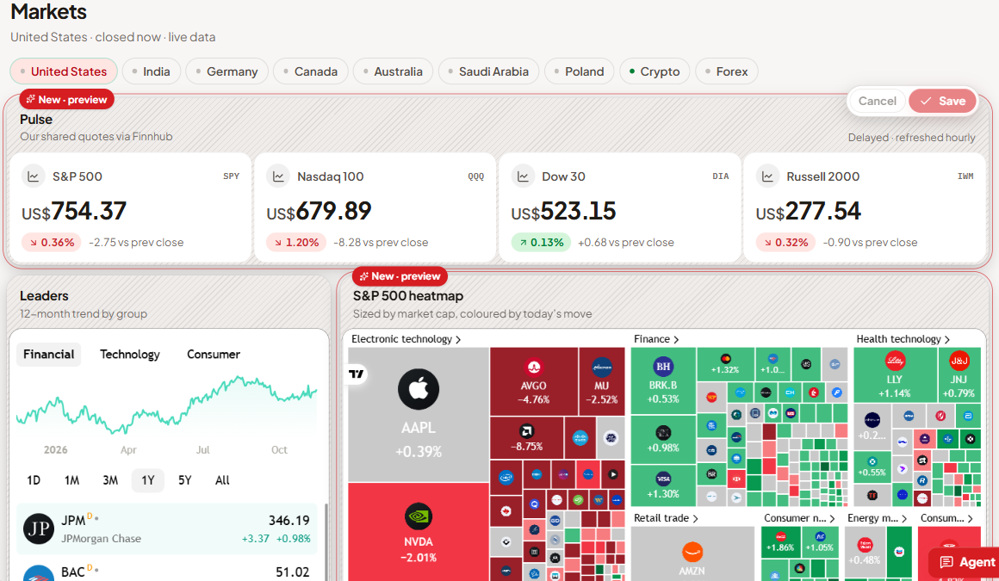

# Smart Finance Hub

**De l'information boursière qu'un débutant peut réellement utiliser, et qu'un expert peut vérifier.**

[English](README.md) · [Spécification](docs/spec.md) · [API de l'agent](docs/agent-api.md) · [Sources de données](docs/data-sources.md)

Smart Finance Hub est une application de cotations et de portefeuille avec un assistant IA. Elle prend des données de marché éparpillées, pleines de jargon et difficiles à croire, et les transforme en explications simples, adaptées à l'expérience et au profil de risque de chaque investisseur. Chaque chiffre affiché peut être retracé jusqu'à sa source.

Réalisé pour le datathon PolyFinances 2026 (défi « AlphaForge AI » : l'IA au service de la décision d'investissement).

> **Simulation seulement.** L'application ne passe aucun ordre réel et ne donne aucun conseil en investissement. Le portefeuille utilise de l'argent fictif.



*L'onglet Aperçu. Les deux panneaux encadrés ont été proposés par l'assistant : ils restent un aperçu jusqu'à ce que l'utilisateur appuie sur **Enregistrer** (ou **Annuler**).*

---

## Le problème et la réponse

| Obstacle | Ce que fait l'application |
|---|---|
| **Information éparpillée** | Cotations, données financières, taux de change, rendements obligataires et cryptos réunis au même endroit, chaque chiffre accompagné de sa **source et de l'heure de collecte**. |
| **Jargon** | Un **assistant IA** explique n'importe quel terme ou chiffre en mots simples, selon le niveau de l'utilisateur (Novice, Intermédiaire, Expert), en **français ou en anglais**, à l'écrit ou à la **voix**. |
| **Une taille unique pour tous** | Un court **questionnaire** fixe le niveau et le profil de risque. La **liste de surveillance** est classée pour ce profil, et l'assistant **nomme le conflit** avec les valeurs réelles quand une demande le dépasse (« la volatilité de ce titre est de 48 %, votre limite est de 25 % »). |
| **Boîtes noires** | La sélection des titres suit des **règles fixes et publiques** ([rules/v1.json](rules/v1.json)), pas un modèle d'IA. Le bouton **« Pourquoi ? »** montre chaque vérification avec ses valeurs. L'assistant ne peut citer que des chiffres venant des données de l'application : une réponse avec un chiffre sans source est rejetée avant d'atteindre l'utilisateur. |
| **Peur du premier pas** | Un **portefeuille simulé** de 10 000 $ CA fictifs, des ordres simulés, des règles automatiques et une **machine à voyager dans le temps** qui rejoue une stratégie sur l'historique réel. |

## Ce que voit l'utilisateur

1. **Accueil et questionnaire** : niveau d'expérience et profil de risque calculés par des règles versionnées. Trois profils d'exemple (`/u/amira`, `/u/mateo`, `/u/robert`) permettent de sauter les questions en démonstration.
2. **Portefeuilles suggérés** pour ce profil, issus d'une table de règles (pas du modèle), présentés comme des exemples pédagogiques.
3. **Liste de surveillance intelligente** : filtres, score à quatre facteurs (profil 40 %, bande de risque 25 %, fondamentaux 20 %, diversification 15 %) et étape de sélection. Aucun modèle d'IA n'intervient dans le filtrage, le score ou le classement.
4. **Portefeuille simulé** : chaque ordre est écrit dans un journal en ajout seul ; le portefeuille est le rejeu de ce journal.
5. **Radiographie du portefeuille** : concentration, part de risque de chaque position, rejeu des proportions actuelles sur le passé (1, 3 et jusqu'à 5 ans) et scénario « et si j'ajoute ou je réduis X ».
6. **Stratégie** : un ensemble de cartes de règles (seuil de prix, cible d'allocation, plafond de poids, garde de repli, achat périodique), créé à la main ou proposé par l'assistant.
7. **Machine à voyager dans le temps** : rejeu du portefeuille sur un instantané Yahoo Finance figé (212 symboles, décembre 2020 à novembre 2026, dividendes réinvestis), avec et sans stratégie, et mode comparaison. Historique illustratif, pas une prédiction.
8. **Fiches de titres** : prix, graphique et données de l'entreprise, avec le fournisseur et l'heure de cotation sous chaque chiffre.
9. **Panneau de l'assistant** : répond, explique, propose des changements (disposition, règles, stratégie, profil, ordres simulés). **Il n'applique jamais rien lui-même** : chaque changement montre un avant/après sur la page concernée, attend une confirmation et peut être annulé. Chaque réponse a une section « Trace » reliée au journal d'audit.

## Comment c'est construit

- **Application web** (Next.js, à la racine) : pages, routes d'API, règles et calculs en fonctions pures et testées, sources de données (Finnhub, TMX Money, Banque du Canada, Kraken, Yahoo en secours), stockage DynamoDB, voix (Amazon Transcribe et Polly).
- **Service d'agent** ([agent/](agent/), Python, Strands Agents SDK) : un orchestrateur (Claude Sonnet 5.5) et sept sous-agents (Claude Haiku 5.5) sur Amazon Bedrock, avec un Guardrail Bedrock.
- **Règle d'or : l'IA ne calcule jamais un chiffre.** Le service d'agent n'a aucune calculatrice. Ses outils appellent l'API interne de l'application, donc chaque nombre est calculé une seule fois, dans du code testé, et l'IA ne fait que l'expliquer.

Le schéma complet de l'architecture est dans le [README en anglais](README.md#how-it-is-built).

## Traçabilité

Chaque chiffre et chaque étape de l'IA peuvent être vérifiés après coup : journal des décisions et journal des actions de l'agent (en ajout seul, protégés par des conditions d'écriture, des droits IAM sans modification ni suppression et la récupération à un instant donné), CloudTrail pour savoir qui a appelé quel modèle et quand, et journalisation des invocations Bedrock dans S3.

## Installer et déployer

Les étapes détaillées (prérequis, `.env`, tables DynamoDB, cache de données, démarrage de l'application et de l'agent, déploiement sur AWS) sont dans le [README en anglais](README.md#setting-it-up). En bref :

```bash
npm ci
cp .env.example .env              # FINNHUB_API_KEY, INTERNAL_API_TOKEN, AWS_REGION
node scripts/create-tables.mjs
node scripts/refresh-signals.mjs  # environ 10 minutes
npm run dev                       # http://localhost:3000
```

Puis, dans un second terminal, démarrer le service d'agent comme décrit à l'étape 7 du README en anglais. Tests : `npm test` et `cd agent && .venv/bin/python -m pytest`.

## Limites connues

- Les valeurs de `rules/v1.json` sont des premières valeurs non éprouvées.
- Le site n'a pas de connexion et tous les visiteurs partagent un utilisateur de démonstration ; ne pas diffuser largement le lien.
- Les données gratuites (Finnhub, TMX Money, Kraken, Yahoo) sont réservées à un usage non commercial : une démonstration, pas un produit.
- Le rejeu de la radiographie ne compte que les variations de prix (pas les dividendes) ; la machine à voyager dans le temps réinvestit les dividendes : les deux chiffres ne sont pas comparables.
- La confidentialité et les avis juridiques n'ont pas fait l'objet d'une revue légale.

La liste complète est dans le [README en anglais](README.md#known-limits).

## Licence et crédits

Ce projet est une version modifiée de [OpenStock](https://github.com/Open-Dev-Society/OpenStock) de l'Open Dev Society et de ses contributeurs, distribuée sous la même licence, la GNU Affero General Public License v3.0 ([LICENSE](LICENSE)). Les listes d'entreprises viennent de Wikipédia (« Liste des sociétés du S&P 500 », « S&P/TSX 60 »), sous licence CC BY-SA 4.0. Les graphiques sont des widgets TradingView.
