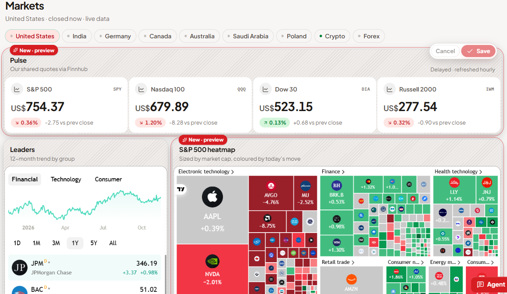
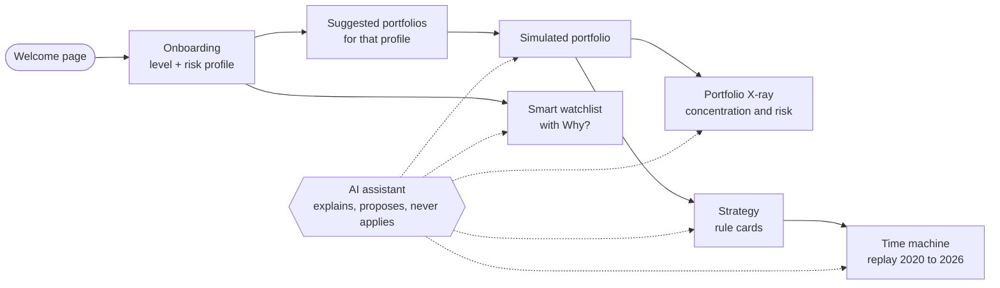
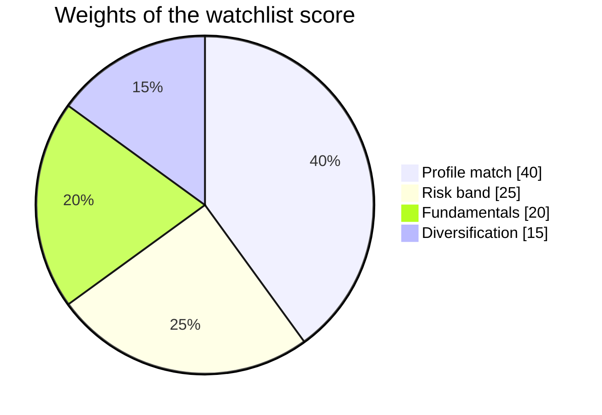
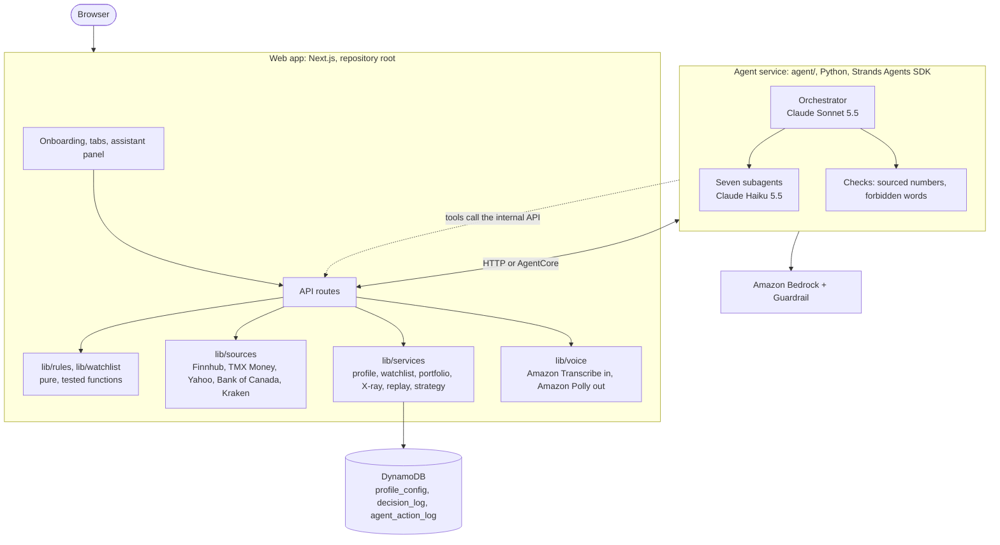
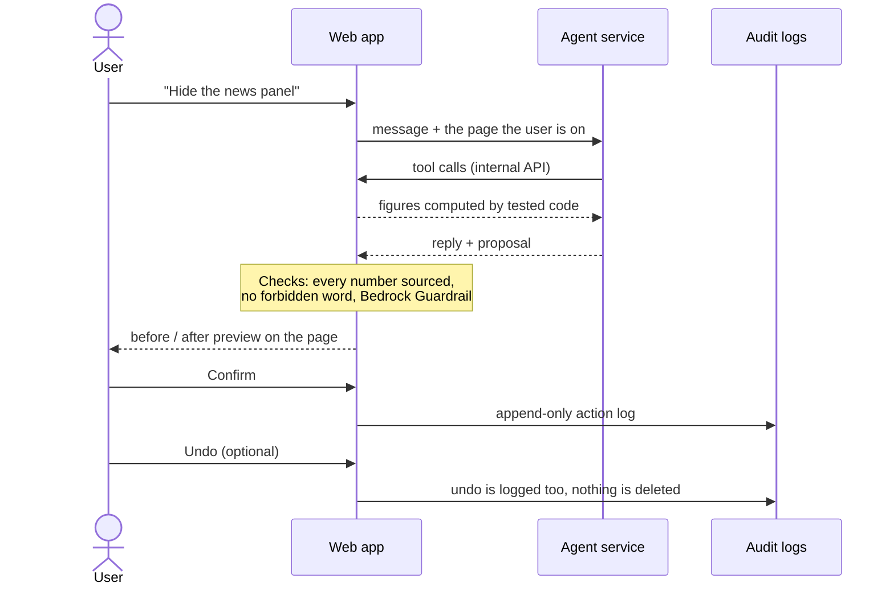
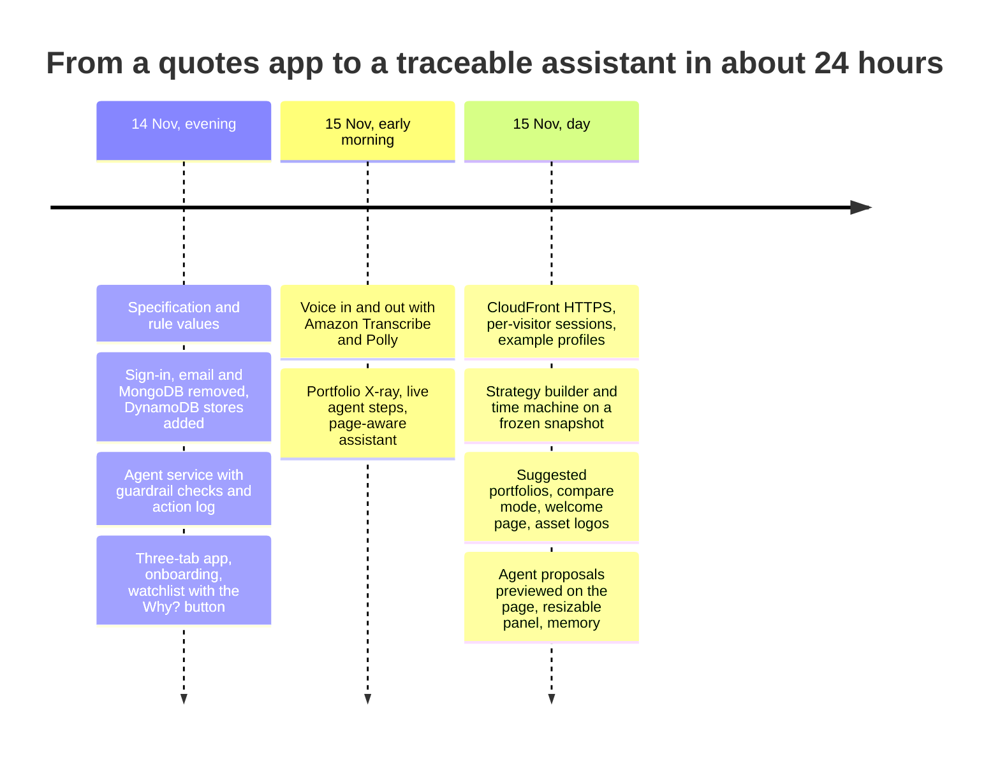

# Smart Finance Hub

**Market information that a beginner can actually use, and that an expert can check.**

[Français](README.fr.md) · [Specification](docs/spec.md) · [Agent API](docs/agent-api.md) · [Data sources](docs/data-sources.md)

    

Smart Finance Hub is a stock and portfolio app with an AI assistant. It takes market data that is scattered, full of jargon and hard to trust, and turns it into plain explanations matched to each investor's experience and risk profile. Every figure it shows can be traced back to where it came from.

Built for the PolyFinances datathon 2026 (challenge "AlphaForge AI": AI for investment decisions).

> **Simulation only.** The app places no real trades and gives no investment advice. The portfolio uses pretend money.



*The Overview tab. The two outlined panels were proposed by the assistant: they stay a preview until the user presses **Save** (or **Cancel**).*

---

## The problem

Most people who want to start investing run into the same walls:

| Barrier | What it looks like today |
|---|---|
| **Information is scattered** | Quotes on one site, fundamentals on another, exchange rates and bond yields on a third. Nobody puts them side by side for *your* situation. |
| **Jargon** | P/E, volatility, drawdown, ETF, yield: the words are a barrier before the numbers are. |
| **One size fits all** | The same screener and the same "top picks" are shown to a first-time saver and to a professional. Nothing says "this is too risky *for you*". |
| **Black boxes** | Robo-advisors and AI chatbots give answers without saying where a number came from or why a stock was picked. A chatbot can also make numbers up. |
| **Fear of the first step** | Learning by trying costs real money. |

The result: the people who most need clear information are the ones least able to get it.

## How Smart Finance Hub solves it

| Barrier | What the app does |
|---|---|
| Scattered information | One app pulls quotes, fundamentals, exchange rates, bond yields and crypto from several sources and shows them together, each figure labelled with its **source and the time it was fetched**. |
| Jargon | An **AI assistant** explains any term or figure in plain words, adapted to the user's level (Novice, Intermediate, Expert). It answers in **English or French**, typed or **spoken**. |
| One size fits all | A short **onboarding** sets the user's experience level and risk profile. The **watchlist** is ranked for that profile, and the assistant **names the conflict** with the actual values when a request goes beyond it (for example: "this stock's volatility is 48 %, your limit is 25 %"). |
| Black boxes | Stock selection uses **fixed, published rules** ([rules/v1.json](rules/v1.json)), not an AI model. A **"Why?"** button on each pick shows every check with its actual values. The assistant may only state numbers that came from the app's own data: a reply with an unsourced number is rejected before it reaches the user. |
| Fear of the first step | A **simulated portfolio** with $10,000 CAD of pretend money, simulated trades, automatic rules, and a **time machine** that replays a strategy on real history, so users learn without risking anything. |

## The user journey



## What a user sees

1. **Welcome page and onboarding**: a few questions, then an experience level (Novice, Intermediate, Expert) and a risk profile (Low, Medium, High) computed with versioned rules. Three example profiles (`/u/amira`, `/u/mateo`, `/u/robert`) let a demo skip the questions; `/u/new` starts a fresh user.
2. **Suggested portfolios**: a few portfolio options for that profile, built from a versioned rules table (not by the model) and labelled as teaching examples.
3. **Smart watchlist**: assets ranked for that profile by filters, a four-factor score and a selection step. No AI model takes part in filtering, scoring or ranking. "Why?" shows the score, each filter check with its actual values, and each input with its source and time.
4. **Simulated portfolio**: trades are filled at the last price held and written to an append-only log; the portfolio is a replay of that log.
5. **Portfolio X-ray**: concentration and each holding's share of the risk, today's proportions replayed over past periods (1, 3 and up to 5 years) as a scenario, and "what if I add or reduce X" before and after, with any profile conflicts. Read-only; the assistant can explain it. Its results are checked against an independent computation in `__tests__/xray/validation.test.ts`.
6. **Strategy**: a strategy is a named set of rule cards (price threshold, allocation target, weight cap, drawdown guard, periodic purchase), built by hand or proposed by the assistant, with a live check against the user's profile.
7. **Time machine**: replays the portfolio on a frozen Yahoo Finance snapshot (212 symbols, December 2020 to November 2026, dividends reinvested), with and without the strategy, side by side, with a benchmark and a compare mode for several runs. Illustrative history, not a prediction.
8. **Stock pages**: price, chart and company data, with the provider and quote time under each figure. Charts are TradingView widgets; clicking a symbol in one opens our own stock page.
9. **Assistant panel** (resizable, with the page it is on in mind): answers questions, explains picks and proposes changes (layout, rules, strategy, profile, simulated trades). It never applies anything itself: each change shows a before/after preview on the page it belongs to, waits for confirmation and can be undone. Its steps stream live, and each reply has a Trace section that links to the audit trail. It can remember the recent conversation (Amazon Bedrock AgentCore Memory, optional).

The full specification is in [docs/spec.md](docs/spec.md).

### How a pick is scored

Every watchlist score is the same four fixed factors, each from 0 to 100 (see `score-v1.1` in [rules/v1.json](rules/v1.json)). The weights are public and no model changes them.



---

## How it is built



One design rule makes the assistant trustworthy: **the AI never computes a figure.** The agent service has no calculators. Its tools call the web app's internal API, so every number is computed once, in plain tested code, and the AI only explains it. The contract between the two is in [docs/agent-api.md](docs/agent-api.md); the agent's own checks are described in [agent/README.md](agent/README.md).

### What happens when the assistant proposes a change



| Folder | Contents |
|---|---|
| [app/](app/) | Next.js pages and API routes (`app/api/*`) |
| [lib/](lib/) | Business logic: rules, watchlist, sources, services, replay, strategy, stores, voice, agent client |
| [components/](components/) | Interface: watchlist, portfolio, X-ray, strategy, replay, agent panel |
| [agent/](agent/) | Python agent service: orchestrator, subagents, checks, prompts, glossary |
| [rules/v1.json](rules/v1.json) | Every threshold, weight and formula |
| [data/](data/) | Stock universe, example profiles, frozen replay snapshot (`data/replay/`) |
| [messages/](messages/) | Interface text in French and English |
| [scripts/](scripts/) | Table creation, data cache, universe builders, replay snapshot builder, `.env` check |
| [infra/](infra/) | AWS setup and deploy scripts |
| [docs/](docs/) | Specification, agent API, data sources, design notes ([index](docs/README.md)) |
| [\_\_tests\_\_/](__tests__/) | Web tests (Vitest); agent tests are in [agent/tests/](agent/tests/) |

## Built during the hackathon

The project was started on 14 November 2026 and built around an assistant that explains but never calculates.



---

## Setting it up

There are two ways to run Smart Finance Hub:

- **Locally**, for development and demos (steps 1 to 7). Needs an AWS account for the AI assistant and DynamoDB, or DynamoDB Local.
- **On AWS**, as a hosted site (see [Deploy to AWS](#deploy-to-aws)).

### Prerequisites

| Tool | Version | Used for |
|---|---|---|
| Node.js | 24 or later | Web app |
| Python + [`uv`](https://docs.astral.sh/uv/) | 3.11 or later (3.13 recommended) | Agent service |
| AWS account | region `us-east-1` | Bedrock (AI), DynamoDB, Transcribe and Polly (voice) |
| AWS CLI | v2 | Credentials and deploy scripts |
| Finnhub key | free at [finnhub.io](https://finnhub.io) | US quotes and fundamentals |
| Docker | optional | Local DynamoDB, or deployment |

### Step 1: Get the code and install dependencies

```bash
git clone <repository-url>
cd Datathon2026-Next-Smart-Finance-Hub
npm ci
```

### Step 2: Configure AWS access

The app and the agent find AWS credentials through the standard AWS chain: environment variables, or a profile in `~/.aws/`. **No AWS key is ever stored in this repository.**

```bash
aws configure                  # access key, secret key, region us-east-1
aws sts get-caller-identity    # check that it works
```

Then, in the AWS console under **Amazon Bedrock → Model access**, enable **Claude Sonnet 5.5** and **Claude Haiku 5.5** in `us-east-1`.

The account needs: Bedrock model invocation, DynamoDB (create tables, read and write), and for voice `transcribe:StartStreamTranscriptionWebSocket` and `polly:SynthesizeSpeech`.

### Step 3: Fill in `.env`

```bash
cp .env.example .env
```

Open `.env` and set at least:

| Variable | Required | What to put |
|---|---|---|
| `FINNHUB_API_KEY` | yes | Your Finnhub key. Several keys separated by commas in `FINNHUB_API_KEYS` are rotated; each adds 60 requests a minute. |
| `INTERNAL_API_TOKEN` | yes | Any long random string, for example `openssl rand -hex 32`. The agent uses it to call the web app's internal API. |
| `AWS_REGION` | recommended | `us-east-1` |
| `GUARDRAIL_ID`, `GUARDRAIL_VERSION` | optional | The Bedrock Guardrail created by `infra/audit.sh`. Unset: that check is skipped and logged as skipped. |
| `ADANOS_API_KEY` | optional | Sentiment card on stock pages (display only). |
| `DYNAMODB_ENDPOINT` | optional | `http://localhost:8000` to use DynamoDB Local instead of AWS. |
| `DEMO_USER_ID` | optional | Change it to start a fresh demo user with an empty portfolio and history. |
| `VOICE_ENABLED` | optional | `true` offers voice input and spoken replies; any other value turns them off. Unset: on in development, off in production. Browsers allow the microphone only over HTTPS or on `localhost`. Transcribe is billed per streamed minute. |

`.env` is ignored by Git: never commit it. Check it with:

```bash
node scripts/check-env.mjs
```

The full list of variables is in [.env.example](.env.example) and [agent/.env.example](agent/.env.example).

### Step 4: Create the database tables

```bash
node scripts/create-tables.mjs
```

This creates the three DynamoDB tables `profile_config`, `decision_log` and `agent_action_log` in your AWS account, or in DynamoDB Local if `DYNAMODB_ENDPOINT` is set.

### Step 5: Warm the market data cache

```bash
node scripts/refresh-signals.mjs     # about 10 minutes
```

This fetches daily data for the whole universe of stocks so that the watchlist has something to rank. Run it again when you want fresher data.

### Step 6: Start the web app

```bash
npm run dev                          # http://localhost:3000
```

The app works at this point. The assistant panel needs step 7.

### Step 7: Start the AI agent service

In a second terminal:

```bash
cd agent
uv venv --python 3.13 && uv pip install -e ".[dev]"
set -a; . ../.env; set +a
WEB_INTERNAL_URL=http://localhost:3000 .venv/bin/python -m app.main     # http://localhost:8080
```

The web app calls `http://localhost:8080` by default (`AGENT_URL` changes it).

### Check that everything works

1. Open http://localhost:3000 and complete the onboarding.
2. The watchlist should show ranked cards. Click **Why?** on one.
3. Ask the assistant "What is an ETF?" in English, or "Qu'est-ce qu'un ETF ?" in French. The reply should have a Trace section.
4. Make a simulated trade and confirm it: it appears in the portfolio.

### Run the tests

```bash
npm test                                  # web: rules, pipeline, stores, sources, services, X-ray, agent router, messages
cd agent && .venv/bin/python -m pytest    # agent service, no AWS needed
```

### Alternative: Docker

```bash
docker compose up
DYNAMODB_ENDPOINT=http://localhost:8000 node scripts/create-tables.mjs
```

This starts the web app with DynamoDB Local. That database is held in memory, so create the tables again after each start. The agent service still runs as in step 7.

---

## Deploy to AWS

Everything runs in `us-east-1`. The web app runs on **ECS Fargate** behind an Application Load Balancer, with a **CloudFront** distribution in front for HTTPS; the agent service runs on **Amazon Bedrock AgentCore Runtime**. Run these steps in order, from the repository root, with a filled-in `.env`:

| Order | Step | What it does |
|---|---|---|
| 1 | `infra/audit.sh` | CloudTrail trail for Bedrock calls, Bedrock invocation logging to S3, and the Guardrail in `infra/guardrail.json`. It prints the Guardrail id: put it in `.env` as `GUARDRAIL_ID`, with `GUARDRAIL_VERSION=1` on a first run. |
| 2 | `node scripts/create-tables.mjs` | The three DynamoDB tables in AWS. |
| 3 | *by hand, once* | Create the AgentCore runtime named `datathon_agent` and its role `datathon-agent-runtime-role` in the console. |
| 4 | `infra/ecs-base.sh` | Copies `FINNHUB_API_KEY`, `ADANOS_API_KEY` and `INTERNAL_API_TOKEN` from `.env` into the AWS Secrets Manager secret `datathon/web`, and creates the IAM roles, security groups and load balancer. Finds the AgentCore runtime and the CloudFront distribution by name. Writes every id and the public address to `infra/outputs.env`, which Git ignores. Safe to re-run. |
| 5 | HTTPS, once | In [infra/cloudfront.json](infra/cloudfront.json), set `DomainName` to your load balancer's address (printed by step 4), then run `aws cloudfront create-distribution --distribution-config file://infra/cloudfront.json`. When the distribution is deployed (a few minutes), run `infra/ecs-base.sh` again so that the public address becomes the `https://…cloudfront.net` one. |
| 6 | `infra/deploy-agent.sh` | Builds the agent image (arm64), pushes it to ECR and updates the AgentCore runtime. |
| 7 | `infra/deploy-web.sh` | Builds the web image, pushes it to ECR and deploys the ECS service. Turns voice on only when the public address is HTTPS. Prints the site URL. |

Without step 5 the site still works over plain HTTP on the load balancer's address, but voice stays off, because browsers allow the microphone only over HTTPS.

Where secrets live once deployed: API keys are in Secrets Manager (`datathon/web`) and injected into the container at start; AWS access comes from the ECS task role, so no AWS key is stored anywhere.

To redeploy after a code change, run steps 6 and/or 7 again.

---

## Traceability

Every figure and every AI step can be checked after the fact.

| What | Where it is recorded |
|---|---|
| Each watchlist run: the full input snapshot, every candidate's filter results and factor scores, rule versions | `decision_log` (append-only) |
| Each pick, user action, simulated trade and profile conflict | `decision_log` |
| Each agent step: prompt version, data used, stated reason, before/after, result, model id, AWS request id, token counts, hashes of prompt and reply | `agent_action_log` (append-only, written by plain code) |
| Who called which model and when | AWS CloudTrail (trail `datathon-llm-audit`, log file integrity validation on) |
| The prompt and reply text of each model call | Bedrock model invocation logging, in S3 |

How append-only is enforced: the code has no update or delete path for the two logs and writes every row with a condition that its id does not exist yet; the deployed task's IAM role has no `UpdateItem` or `DeleteItem` on them; and point-in-time recovery is on, so an earlier state can be restored and compared. IAM alone would not stop an unconditional overwrite, so the guarantee is these three together.

To look up one model call on AWS, take the `awsRequestId` from the Trace section of a reply and run:

```bash
infra/lookup-call.sh <aws-request-id>
```

CloudTrail lags by about five minutes. It records the call, not the text; the text is in the invocation log.

## Customising

- **Rules**: every threshold, weight and formula (profile scoring, watchlist filters, factor weights, forbidden words) is in [rules/v1.json](rules/v1.json). Change the values there; no code change is needed.
- **Interface text**: [messages/en/](messages/en/) and [messages/fr/](messages/fr/).
- **Glossary used by the assistant**: [agent/glossary/](agent/glossary/) (English) and `agent/glossary/fr/` (French).
- **Stock universe**: `scripts/build-universe.mjs` and `scripts/build-us-tickers.mjs`.

## Data sources and their limits

Details, endpoints and terms of use are in [docs/data-sources.md](docs/data-sources.md). In short:

- Bank of Canada (bond yields, USD/CAD) is open and licensed for reuse with attribution.
- Finnhub (US quotes and fundamentals), TMX Money (Canadian quotes and daily closes) and Kraken (crypto) work without a paid plan, but their terms allow personal or non-commercial use only. This is a non-commercial demo; a real product would license market data.
- Yahoo's chart endpoint is unofficial and often refuses automated calls. It is used only as a fallback and labelled as unofficial.
- The ESG tag on cards is demo data set by hand. It is not real ESG data and says nothing about the real company.
- No free, licensed source of TSX quotes or price history was found.

## Known limits

- The rule values in `rules/v1.json` are untested first values.
- A Bedrock Knowledge Base could not be created on the workshop account (the action is denied), so the glossary is served from the vetted files in `agent/glossary/`, quoted and cited the same way. Setting `KNOWLEDGE_BASE_ID` switches to a Knowledge Base.
- The Guardrail blocks the forbidden words and ungrounded replies. Its "investment advice" topic and relevance check only detect and log, because they refused correct factual replies when set to block.
- Gold has no price: the only free source found (Yahoo futures) refused the calls.
- Canadian stocks have no revenue-growth figure and no news count; the universe has no Canadian health-care names.
- Some state lives in a file inside the web container and is lost when the task restarts or is redeployed: the saved layout, investment rules, pins and dismissals, pending agent previews with their undo data, and the slow-moving state of the watchlist (which symbols were listed and since when). After a restart the next watchlist run starts without incumbents. The profile, both logs and therefore the portfolio are in DynamoDB and persist.
- Privacy consent and legal disclaimers have not had a legal review.
- The site has no sign-in, and every visitor shares the one demo user. HTTPS comes from CloudFront in front of the load balancer; the load balancer's own address is still reachable over plain HTTP. The agent route is limited to 10 requests a minute; the voice routes have per-visitor limits and a daily cap. Do not share the link widely; set a new `DEMO_USER_ID` before a presentation to start from a clean history.
- The X-ray replay counts price changes only (no dividends). Crypto history is about two years (Kraken's 720 daily bars), so a window it does not cover leaves it out and says so.
- Price alerts and the earnings calendar are not built. On the Overview tab the assistant can hide or show panels but not reorder them; only the Portfolio tab's modules can be rearranged.

## Licence and credits

This project is distributed under the GNU Affero General Public License v3.0 ([LICENSE](LICENSE)).

Under the AGPL, anyone who runs a modified version as a network service must offer its source to its users under the same licence.

Company lists come from Wikipedia ("List of S&P 500 companies", "S&P/TSX 60"), used under CC BY-SA 4.0. Charts are TradingView widgets.
